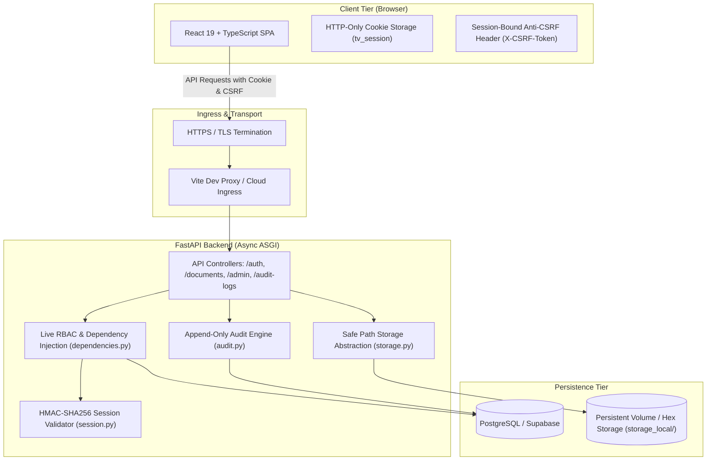
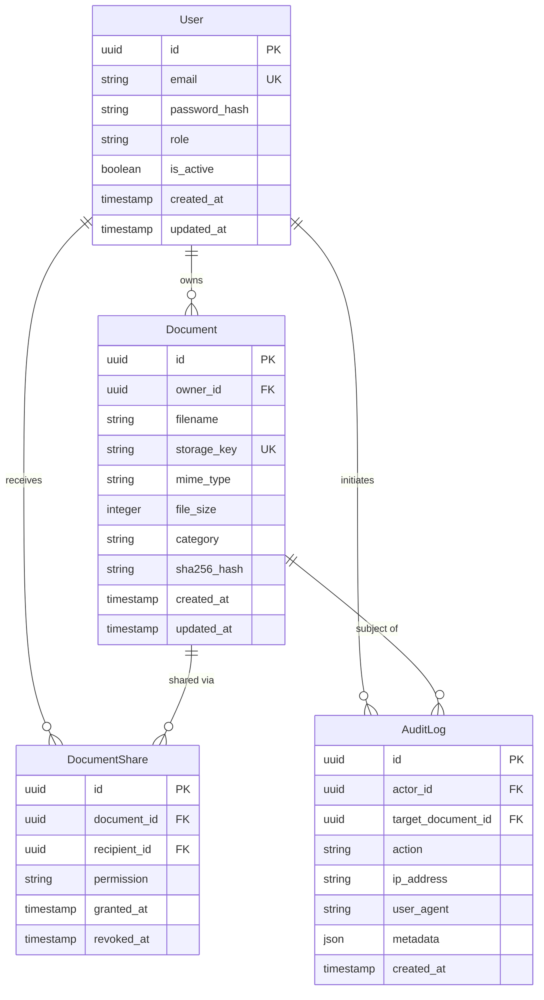
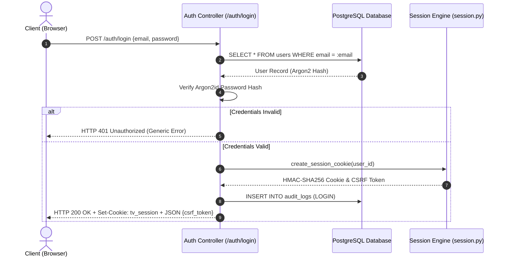
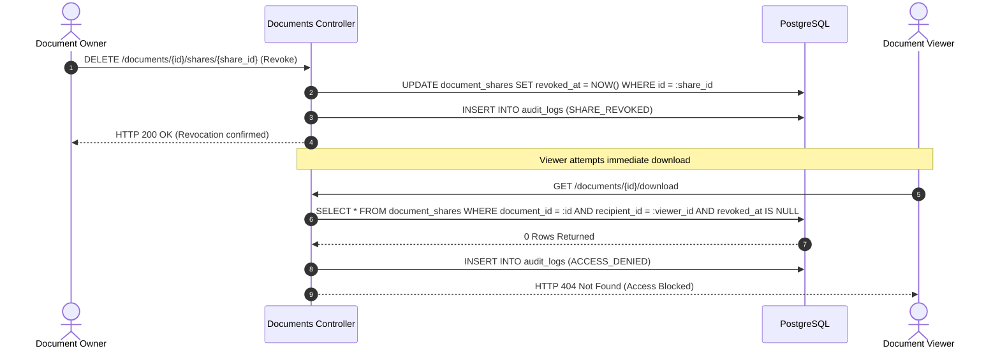
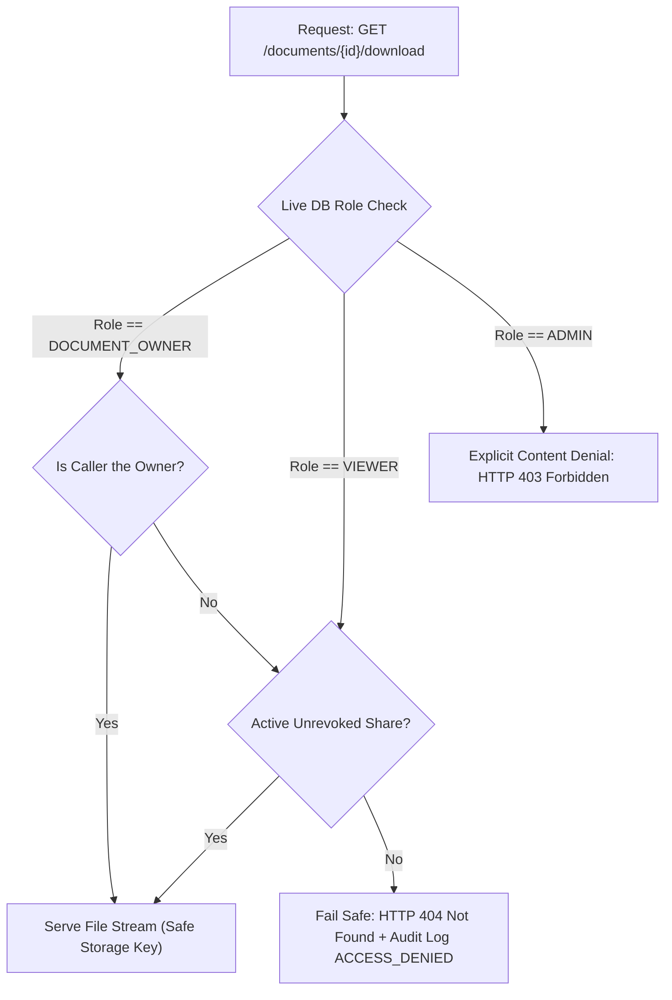

# TrustVault — Architecture & Engineering Design

This document details the architectural blueprints, component interactions, threat boundaries, and cryptographic models implemented across **TrustVault**.

---

## 1. High-Level System Architecture

TrustVault operates as a decoupled multi-tier web application structured around the **Zero-Trust principle**: *never trust, always verify*. Client-side state, tokens, or route guards are treated as untrusted user interface helpers; every mutating or data-fetching operation is independently verified at the server and database level.



---

## 2. Entity-Relationship Data Model

The relational persistence tier is managed via **SQLAlchemy 2.0 ORM** and declarative **Alembic migrations**.



---

## 3. Core Cryptographic & Security Workflows

### 3.1 Authentication & Session Issuance

1. The client posts credentials to `POST /auth/login`.
2. The server queries the database for the user record and verifies the Argon2id password hash using `pwdlib`.
3. If valid, the session subsystem generates an unpredictable UUID `session_id`.
4. The server creates an HMAC-SHA256 signature combining `user_id`, `session_id`, and `exp` timestamp using `SESSION_SECRET`.
5. The signed token is sent as an `HttpOnly`, `SameSite=Lax` cookie (`tv_session`).
6. A derived anti-CSRF token is generated from `HMAC-SHA256("trustvault-csrf:" + session_id, SESSION_SECRET)` and returned in the JSON payload for client header injection.



---

### 3.2 Granular Sharing & Instantaneous Revocation

When an owner shares a document:
- A new row is inserted into `document_shares` with `granted_at = NOW()` and `revoked_at = NULL`.
- If an email notification fails or SMTP is unconfigured, the share is still persisted, and `email_notification_sent: false` is truthfully returned.

When an owner revokes access:
- `DELETE /documents/{id}/shares/{share_id}` sets `revoked_at = NOW()`.
- Every subsequent file download query explicitly filters:
  ```sql
  WHERE document_shares.revoked_at IS NULL
  ```
- Because there is no intermediary token caching, revocation propagates instantly on the very next HTTP transaction.



---

### 3.3 Separation of Administrative Duties (Least Privilege)

TrustVault strictly enforces separation of duties:
- **Administrators (`ADMIN`)**: Can list users, update roles, view document counts, and inspect the complete enterprise audit trail.
- **Content Restriction**: When an administrator requests `GET /documents/{id}/download`, the backend explicitly denies access (`HTTP 403 Forbidden`) unless the document owner explicitly shared the file with the admin.



---

## 4. Protected Storage Subsystem

1. **Unpredictable Storage Keys**: Files are written to disk using a 48-character random hexadecimal key (`secrets.token_hex(24)`), preventing enumeration.
2. **Path Traversal Defense**: The storage adapter resolves canonical file paths with `_resolve_safe_path` to guarantee that all operations remain bounded inside `STORAGE_DIR`.
3. **MIME & Signature Verification**: Uploads are inspected against a strict whitelist of content types (`PDF`, `PNG`, `JPEG`, `DOCX`, `TXT`) and capped at 10 MB.
4. **Header Hardening**: Download responses include `X-Content-Type-Options: nosniff` and `Cache-Control: no-store, no-cache, must-revalidate`.
