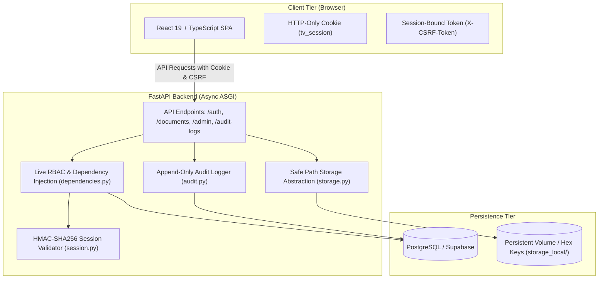

# TrustVault — Enterprise Secure Document Sharing & Zero-Trust Audit System

[](https://www.python.org/)
[](https://fastapi.tiangolo.com/)
[](https://react.dev/)
[](https://www.typescriptlang.org/)
[](https://tailwindcss.com/)
[]()
[]()

> **Author:** [Harika Vadalasetty](https://github.com/Harika-Vadalasetty)  
> **Repository:** [https://github.com/Harika-Vadalasetty/TrustVault](https://github.com/Harika-Vadalasetty/TrustVault)

---

## 📸 System Overview


**TrustVault** is an enterprise-grade document sharing and compliance auditing platform built strictly upon **Zero-Trust** principles and defense-in-depth security:

- **Server-Side Live Authorization:** The client state is never trusted. Every HTTP transaction queries the live database record to verify permissions.
- **Cryptographic Session Integrity:** Tamper-resistant HMAC-SHA256 signed session cookies (`HttpOnly`, `SameSite=Lax`) with timestamp expiration.
- **Session-Bound Anti-CSRF Defense:** Double-submit cookie mitigation with constant-time cryptographic verification (`hmac.compare_digest`).
- **Hardened File Storage:** Files are stored under unpredictable 48-character hexadecimal keys with path-traversal prevention (`_resolve_safe_path`) and SHA-256 integrity digests.
- **Separation of Duties (Least Privilege):** Administrators manage accounts and inspect system telemetry, but are **strictly barred** by the backend from downloading private user document contents.
- **Instantaneous Revocation:** Revoking a document share immediately terminates access on the very next HTTP request with zero caching delay.
- **Append-Only Audit Trail:** Comprehensive PostgreSQL audit logging of all logins, uploads, downloads, sharing grants, revocations, deletions, role updates, and access denials.

---

## 📑 Core Documentation Links

| Document | Description |
|---|---|
| 📐 [**ARCHITECTURE.md**](./ARCHITECTURE.md) | Component blueprints, sequence diagrams, and ER data models |
| 🛡️ [**THREATS.md**](./THREATS.md) | Threat Model & 13-point automated test verification matrix |
| 🔒 [**SECURITY.md**](./SECURITY.md) | Security policy, disclosure procedures, and architectural boundaries |
| 🚀 [**DEPLOYMENT.md**](./DEPLOYMENT.md) | Local, Docker Compose, and cloud production deployment guides |
| 🎬 [**DEMO_SCRIPT.md**](./DEMO_SCRIPT.md) | 5-minute hackathon presentation and screen recording walkthrough |

---

## 🛠️ System Architecture



---

## 🚀 Key Features

### 1. Role-Based Access Control (RBAC)
- **Administrator (`ADMIN`):** Inspects enterprise telemetry, audits security logs, promotes/demotes user roles with sole-admin demotion safeguards. *Explicitly barred from downloading private user files.*
- **Document Owner (`DOCUMENT_OWNER`):** Uploads documents, searches vault, inspects SHA-256 hashes, shares files with recipients, and revokes access instantly.
- **Viewer (`VIEWER`):** Discovers and downloads only explicitly shared documents. Cannot upload, share, or delete files. All public registrations default to `VIEWER`.

### 2. Document Intelligence Inspector
- Interactive modal revealing the cryptographic SHA-256 hash, randomized 48-char storage key, MIME type, file size, and cache-control headers.

### 3. Immediate Permission Revocation
- When an owner revokes a grant, the record is immediately flagged in the database. The viewer is denied access on the very next HTTP transaction with zero propagation delay.

### 4. Transparent Email Reporting
- If SMTP credentials are not configured, TrustVault records the share in the database and truthfully reports `email_notification_sent: false` with an explanatory note rather than faking delivery.

---

## ⚡ Quick Start: Running Locally

### Option A: Turnkey Docker Compose (Fastest)

```bash
# Clone the repository
git clone https://github.com/Harika-Vadalasetty/TrustVault.git
cd TrustVault

# Run backend and frontend containers
docker compose up --build
```
- **Web Interface:** `http://localhost:5173`
- **Backend API Docs:** `http://localhost:8000/docs`

---

### Option B: Local Python & Node Environment

#### 1. Prerequisites
- Python 3.11+ (Python 3.13 verified)
- Node.js 18+ and npm
- PostgreSQL database (or local SQLite for testing)

#### 2. Backend Setup
```powershell
Set-Location "backend"

# Activate virtual environment
..\.venv\Scripts\Activate.ps1

# Install dependencies
pip install -r requirements.txt

# Run migrations and seed accounts
alembic upgrade head
python scripts/seed.py

# Start FastAPI server
uvicorn app.main:app --reload --port 8000
```

#### 3. Frontend Setup
```powershell
Set-Location "frontend"
npm install
npm run dev
```
Open **`http://localhost:5173`** in your browser.

---

## 🔑 Pre-Configured Demo Accounts

| Role | Email | Demo Password | Capabilities |
|---|---|---|---|
| **Administrator** | `admin@trustvault.local` | `TrustVaultDemo@2026!` | User governance, enterprise audit logs, metrics |
| **Document Owner** | `owner@trustvault.local` | `TrustVaultDemo@2026!` | Document upload, search, share grant & instant revoke |
| **Viewer** | `viewer@trustvault.local` | `TrustVaultDemo@2026!` | Access and download active shares only |

*(1-Click Demo Fill buttons are available on the login page for instantaneous evaluation).*

---

## 🧪 Verification & Real Test Results

The entire codebase is verified by an automated test suite containing **60 integration and unit tests**:

```powershell
Set-Location "backend"
..\.venv\Scripts\python.exe -m pytest -v
```

```text
============================= test session starts =============================
platform win32 -- Python 3.13.14, pytest-8.4.2, pluggy-1.7.0
rootdir: backend
configfile: pytest.ini
testpaths: tests
plugins: anyio-4.15.1
collected 60 items

tests/test_admin.py (5 tests) ........................................ PASSED
tests/test_auth.py (10 tests) ....................................... PASSED
tests/test_dependencies.py (11 tests) ............................... PASSED
tests/test_documents.py (15 tests) .................................. PASSED
tests/test_health.py (2 tests) ...................................... PASSED
tests/test_session.py (17 tests) .................................... PASSED

================= 60 passed, 81 warnings in 67.58s (0:01:07) ==================
```

Frontend production compilation:
```powershell
Set-Location "frontend"
npm run build
```
```text
✓ 1934 modules transformed.
dist/index.html                   0.45 kB │ gzip:  0.29 kB
dist/assets/index-CsKlCaJ5.css   48.75 kB │ gzip:  8.40 kB
dist/assets/index-BuZlINNr.js   333.97 kB │ gzip: 88.36 kB
✓ built in 1.45s
```

---

## 📡 API Reference Summary

### Authentication (`/auth`)
- `POST /auth/register` — Register new user account (restricted to `VIEWER` role).
- `POST /auth/login` — Authenticate credentials, issue signed `tv_session` cookie and CSRF token.
- `POST /auth/logout` — Revoke active session (CSRF protected).
- `GET /auth/me` — Return authenticated user profile and refresh anti-CSRF token.

### Documents & Sharing (`/documents`)
- `POST /documents` — Upload new file (`DOCUMENT_OWNER` or `ADMIN`; max 10MB; CSRF protected).
- `GET /documents` — List documents (Owner sees own; Viewer sees active shares; Admin sees metadata).
- `GET /documents/recipients` — List eligible share recipient emails (`DOCUMENT_OWNER` only).
- `GET /documents/{id}` — Retrieve document metadata.
- `GET /documents/{id}/download` — Stream file content (Owner & active share recipients; Admin content denied).
- `DELETE /documents/{id}` — Delete file and revoke associated shares (Owner only; CSRF protected).
- `POST /documents/{id}/shares` — Create new share grant (Owner only; CSRF protected).
- `GET /documents/{id}/shares` — List all active and revoked shares for a document (Owner only).
- `DELETE /documents/{id}/shares/{share_id}` — Instant share revocation (Owner only; CSRF protected).

### Administration (`/admin`)
- `GET /admin/users` — List registered users with document counts (`ADMIN` only).
- `PATCH /admin/users/{id}/role` — Update user role with sole-admin protection (`ADMIN` only; CSRF protected).
- `GET /admin/stats` — Retrieve system telemetry and metrics (`ADMIN` only).

### Audit Logs & Health
- `GET /audit-logs` — Scoped audit logs (Owner sees own/doc events; Viewer sees personal; Admin sees all).
- `GET /health` — Service liveness probe.
- `GET /health/db` — PostgreSQL database connectivity probe.

---

## 🔮 Future Roadmap & Limitations

- [ ] **KMS Client-Side Envelope Encryption:** Integrate AWS KMS or HashiCorp Vault for per-document envelope encryption.
- [ ] **FIDO2 / WebAuthn Passkeys:** Enable hardware-backed multi-factor authentication.
- [ ] **Granular Share Expirations:** Support automatic TTL-based expiration timestamps for shared documents.
- [ ] **Cloud Storage Adapters:** Native integration with AWS S3 and Azure Blob Storage alongside local storage.

---

## 📄 License & Attribution

Developed with defense-in-depth engineering standards by **[Harika Vadalasetty](https://github.com/Harika-Vadalasetty)**.  
Licensed under the [MIT License](LICENSE).
